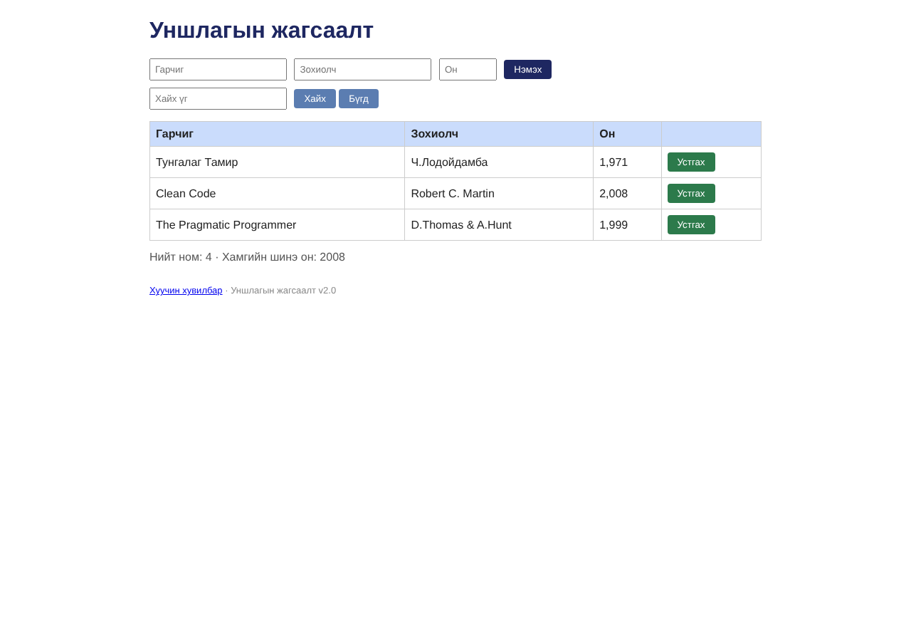

# BUG-01: Хүснэгтийн «Он» баганад оныг мянгатын таслалтай (1,971) харуулдаг

Орчин:  Уншлагын жагсаалт v2.0, Chromium 153.0.8010.12, Linux x86_64 (Node.js v22.23.4), 2026-10-24

Урьдчилсан нөхцөл: node app.js-ийг шинээр асаасан (анхны 3 ном), браузерт http://localhost:3000 нээсэн

## Дахин гаргах алхам

1. Хуудсыг нээнэ.
2. Хүснэгтийн «Он» баганыг харна.

Хүлээгдэж байсан: Спец: «Он нь 1000-2100 хоорондох бүхэл тоо; хүснэгтэд энгийн тоогоор (жишээ нь 1999) харагдана.»

Бодит үр дүн:     Анхны 3 номын он «1,971», «2,008», «1,999» гэж мянгатын таслалтай харагдана. Шинээр нэмсэн ном ч мөн адил (2001 -> «2,001»).

Ноцтой байдал: Minor — өгөгдөл зөв, харагдац буруу; хэрэглэгч ондоо таслалтай тоо хүлээдэггүй, андуурал үүсгэнэ.

Хавсралт:      

Олдсон аялал:  Supermodel
