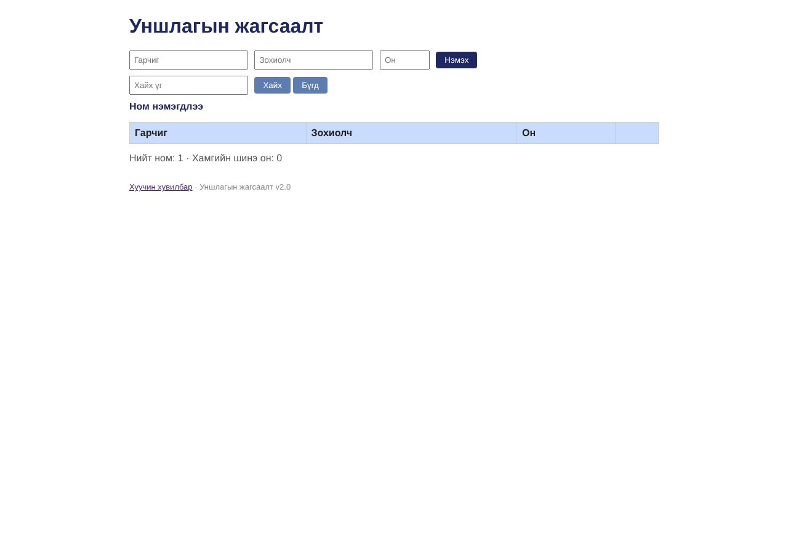

# BUG-02: «Нийт ном» тоолуур хүснэгтийн мөрийн тооноос үргэлж 1-ээр их

Орчин:  Уншлагын жагсаалт v2.0, Chromium 153.0.8010.12, Linux x86_64 (Node.js v22.23.4), 2026-10-24

Урьдчилсан нөхцөл: node app.js-ийг шинээр асаасан (анхны 3 ном), браузерт http://localhost:3000 нээсэн

## Дахин гаргах алхам

1. Хуудсыг нээнэ. Хүснэгтэд 3 мөр, доор «Нийт ном: 4» харагдана.
2. Гарчиг «Шинэ», Зохиолч «Т», Он «2005» бөглөж «Нэмэx» дарна -> 4 мөр, «Нийт ном: 5».
3. Эхний мөрийн «Устгах» дарна -> 3 мөр, «Нийт ном: 4».
4. API түвшинд: `curl -i localhost:3000/api/stats` -> `"total":4`, `curl -i localhost:3000/api/books` -> 3 ном.

Хүлээгдэж байсан: Спец: «Нийт ном» тоолуур хүснэгтэд буй номын тоотой тэнцүү.

Бодит үр дүн:     Бүх төлөвт тоолуур = мөрийн тоо + 1 (3/4, 4/5, 3/4, бүх номыг устгахад 0/1). /api/stats total нь /api/books-ийн тооноос 1-ээр их.

Ноцтой байдал: Major — үндсэн статистик үргэлж буруу; өгөгдлийн (API) түвшний алдаа тул UI-аас хамаарахгүй.

Хавсралт:       · [evidence/bug-02-stats-curl.txt](../evidence/bug-02-stats-curl.txt) · [evidence/bug-02-books-curl.txt](../evidence/bug-02-books-curl.txt) · 

Олдсон аялал:  Supermodel, Fed-Ex
