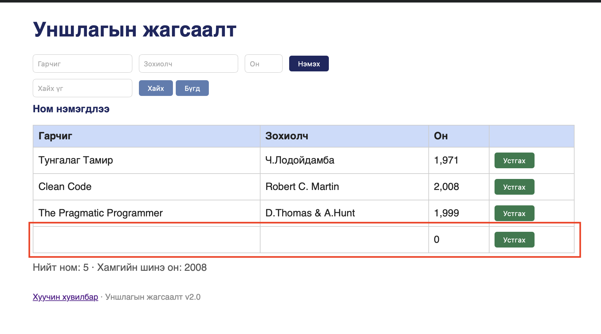

# BUG-02: Хоосон утгатай номын мөр нэмэгдэж байна

- **Status:** Confirmed
- **Test result:** FAIL
- **Type:** UI / Input validation
- **Severity:** Major

## Environment
- Application: http://localhost:3000/
- Browser: Safari 26.6.2
- OS: macOS

## Preconditions
Application нээлттэй, ном нэмэх форм ашиглах боломжтой байна.

## Steps to Reproduce
1. Ном нэмэх формыг нээнэ.
2. Шаардлагатай талбаруудыг хоосон үлдээнэ.
3. Нэмэх үйлдлийг гүйцэтгэнэ.
4. Номын хүснэгтэд шинэ мөр нэмэгдсэн эсэхийг шалгана.

## Expected Result
Хоосон утгатай ном нэмэгдэхгүй. Хэрэглэгчид шаардлагатай талбаруудыг бөглөх тухай validation мэдэгдэл харуулна.

## Actual Result
Тестийн ажиглалтаар хоосон утгатай мөр хүснэгтэд нэмэгдсэн.

## Screenshot

## Test Result
FAIL — хоосон утгатай мөр нэмэгдэхээс сэргийлээгүй.
