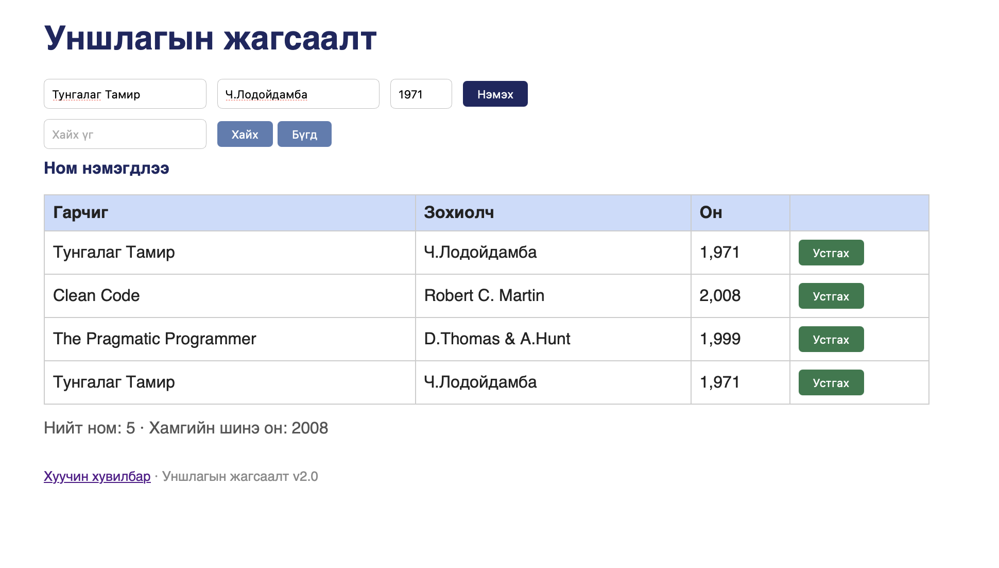

# BUG-03: Ижил гарчиг, зохиолчтой ном давхар нэмэгдэж байна

- **Status:** Confirmed
- **Test result:** FAIL
- **Type:** UI / Duplicate validation
- **Severity:** Major

## Environment

- Application: http://localhost:3000/
- Browser: Safari 26.6.2
- OS: macOS

## Preconditions

Application ажиллаж, ном нэмэх форм ашиглах боломжтой байна.

## Steps to Reproduce

1. Ном нэмэх формд дараах утгыг оруулна:
   - Гарчиг: `Тунгалаг Тамир`
   - Зохиолч: `Ч.Лодойдамба`
   - Он: `1971`
2. `Нэмэх` товчийг дарна.
3. Ижил гарчиг (`Тунгалаг Тамир`), ижил зохиолч (`Ч.Лодойдамба`), ижил он (`1971`)-той номыг дахин нэмнэ.
4. Хүснэгт дэх ижил гарчиг, зохиолчтой мөрүүдийн тоог шалгана.

## Expected Result

Ижил гарчиг болон зохиолчтой ном давхар нэмэгдэхгүй. Хэрэглэгчид ойлгомжтой мэдэгдэл харуулна.

## Actual Result

Ижил гарчиг `Тунгалаг Тамир`, зохиолч `Ч.Лодойдамба`, он `1971`-той номыг хоёр удаа нэмэхэд хүснэгтэд 2 мөр үүссэн.

## Screenshot

## Test Result

FAIL — ижил гарчиг болон зохиолчтой ном давхар нэмэгдэж, хүснэгтэд 2 мөр үүссэн.
