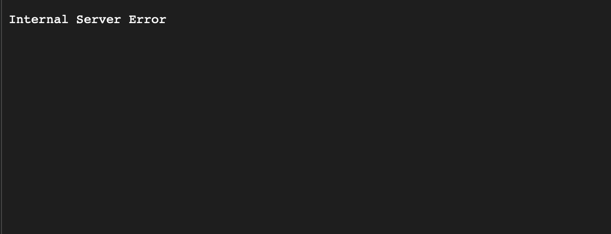

# BUG-04: Хуучин хувилбарын холбоос серверийн алдаа үүсгэж байна

- **Status:** Confirmed
- **Test result:** FAIL
- **Type:** UI / Navigation
- **Severity:** Major

## Environment
- Application: http://localhost:3000/
- Browser: Safari 26.6.2
- OS: macOS

## Preconditions
Application-ийн үндсэн хуудас нээлттэй байна.

## Steps to Reproduce
1. http://localhost:3000/ хаягаар аппыг нээнэ.
2. "Хуучин хувилбар" холбоосыг олно.
3. Холбоос дээр дарна.
4. Нээгдсэн хуудасны үр дүнг ажиглана.

## Expected Result
Холбоосоор зорьсон хуудас амжилттай нээгдэнэ.

## Actual Result
`Internal Server Error` гарсан.

## Screenshot

## Test Result
FAIL — холбоос хүлээгдсэн хуудсыг нээж чадсангүй.
