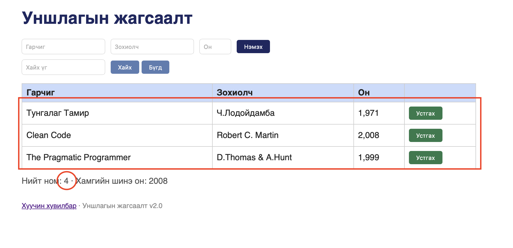

# BUG-05: Номын тоолуур хүснэгтийн мөрийн тоотой зөрж байна

- **Status:** Confirmed
- **Test result:** FAIL
- **Type:** UI / Data consistency
- **Severity:** Major

## Environment

- Application: http://localhost:3000/
- Browser: Safari 26.6.2
- OS: macOS

## Preconditions

Application ажиллаж, номын жагсаалт харагдаж байна.

## Steps to Reproduce

1. Application-ийг шинээр нээнэ.
2. Бүх номын жагсаалтыг харуулах `Бүгд` товчийг дарна.
3. Хүснэгтэд харагдаж буй номын мөрүүдийг тоолно.
4. `Нийт ном` тоолуурын утгыг тэмдэглэнэ.
5. Хүснэгтийн мөрийн тоо болон тоолуурын утгыг харьцуулна.

## Expected Result

`Нийт ном` тоолуурын утга нь жагсаалтад харуулж буй номын нийт тоотой нийцсэн байна.

## Actual Result

Application-ийг нээж, `Бүгд` товчийг дарсны дараа хүснэгтэд 3 номын мөр харагдсан боловч `Нийт ном` тоолуур 4 гэж харуулсан.

- Хүснэгтийн мөрийн тоо: 3
- Тоолуурын утга: 4
- Зөрүү: 1

## Screenshot

## Test Result

FAIL — хүснэгтэд 3 мөр байхад тоолуур 4 гэж харуулсан.
