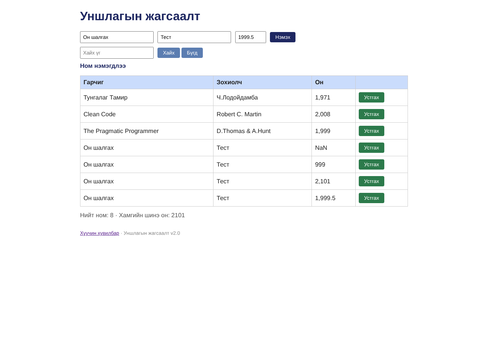

# BUG-06: «Он» талбар 1000-2100 муж ба бүхэл тоог шалгадаггүй (abc, 999, 2101, 1999.5 бүгд нэмэгдэнэ)

Орчин:  Уншлагын жагсаалт v2.0, Chromium 153.0.8010.12, Linux x86_64 (Node.js v22.23.4), 2026-10-24

Урьдчилсан нөхцөл: node app.js-ийг шинээр асаасан (анхны 3 ном), браузерт http://localhost:3000 нээсэн

## Дахин гаргах алхам

1. Гарчиг «Он шалгах», Зохиолч «Тест», Он «abc» бөглөж «Нэмэx» дарна.
2. Он-ыг «999» болгож «Нэмэx» дарна.
3. Он-ыг «2101» болгож «Нэмэx» дарна.
4. Он-ыг «1999.5» болгож «Нэмэx» дарна.
5. Хүснэгт ба доод талын «Хамгийн шинэ он»-ыг харна.

Хүлээгдэж байсан: Спец: «Он нь 1000-2100 хоорондох бүхэл тоо»; буруу бол ном нэмэгдэхгүй, алдааны мессеж гарна.

Бодит үр дүн:     Дөрвүүлээ «Ном нэмэгдлээ» гэж нэмэгдэж, хүснэгтэд «NaN», «999», «2,101», «1,999.5» гэж харагдана; «Хамгийн шинэ он: 2101» болно. API ч мөн адил: year 5000 болон "abc" -> 201 Created, /api/stats newest=5000.

Ноцтой байдал: Major — буруу өгөгдөл хадгалагдаж, статистик («Хамгийн шинэ он») гажна.

Хавсралт:       · [evidence/bug-06-curl.txt](../evidence/bug-06-curl.txt)

Олдсон аялал:  Couch Potato, Saboteur
