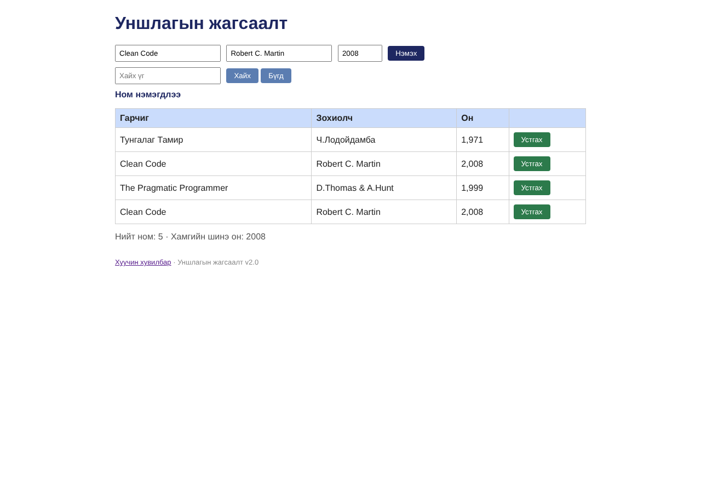

# BUG-07: Ижил гарчиг, зохиолчтой ном давхардаж нэмэгддэг

Орчин:  Уншлагын жагсаалт v2.0, Chromium 153.0.8010.12, Linux x86_64 (Node.js v22.23.4), 2026-10-24

Урьдчилсан нөхцөл: node app.js-ийг шинээр асаасан (анхны 3 ном), браузерт http://localhost:3000 нээсэн

## Дахин гаргах алхам

1. Гарчиг «Clean Code», Зохиолч «Robert C. Martin», Он «2008» бөглөж «Нэмэx» дарна.
2. Хүснэгтийг харна.

Хүлээгдэж байсан: Спец: «Ижил гарчиг, зохиолчтой ном давхардуулж нэмэгдэхгүй.»

Бодит үр дүн:     «Ном нэмэгдлээ» гарч, «Clean Code / Robert C. Martin / 2,008» хүснэгтэд 2 удаа (2 ба 4-р мөр) харагдана. «Нэмэx»-ийг дараалан 5 удаа дарахад 5 ижил мөр нэмэгдсэн.

Ноцтой байдал: Major — давхардлын дүрэм огт хэрэгжээгүй; жагсаалт ба тоолуур бохирдоно.

Хавсралт:      

Олдсон аялал:  Couch Potato
