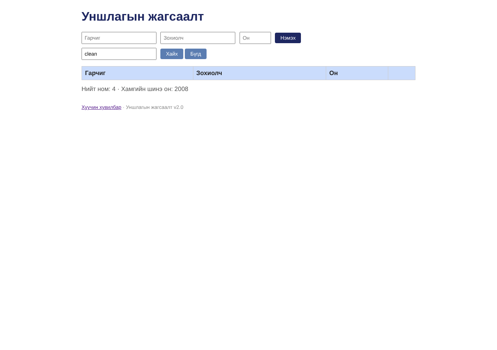

# BUG-08: Хайлт том/жижиг үсэг ялгадаг — «clean» гэхэд «Clean Code» олдохгүй

Орчин:  Уншлагын жагсаалт v2.0, Chromium 153.0.8010.12, Linux x86_64 (Node.js v22.23.4), 2026-10-24

Урьдчилсан нөхцөл: node app.js-ийг шинээр асаасан (анхны 3 ном), браузерт http://localhost:3000 нээсэн

## Дахин гаргах алхам

1. «Хайх үг» талбарт «clean» (жижиг үсгээр) бичээд «Хайх» дарна.
2. Үр дүнг харна.
3. «Clean» гэж бичээд «Хайх» дарна.

Хүлээгдэж байсан: Спец: «Хайлт гарчиг болон зохиолчоос хайх ба том/жижиг үсэг ЯЛГАХГҮЙ.»

Бодит үр дүн:     «clean» -> хүснэгт хоосон (0 мөр). «Clean» -> «Clean Code» олдоно. Зохиолч болон кирилл дээр ч мөн адил: «fowler»/«тамир» -> 0, «Fowler»/«Тамир» -> олдоно.

Ноцтой байдал: Major — хайлтын үндсэн шаардлага зөрчигдөж, хэрэглэгч байгаа номоо олж чадахгүй.

Хавсралт:      

Олдсон аялал:  Supermodel
