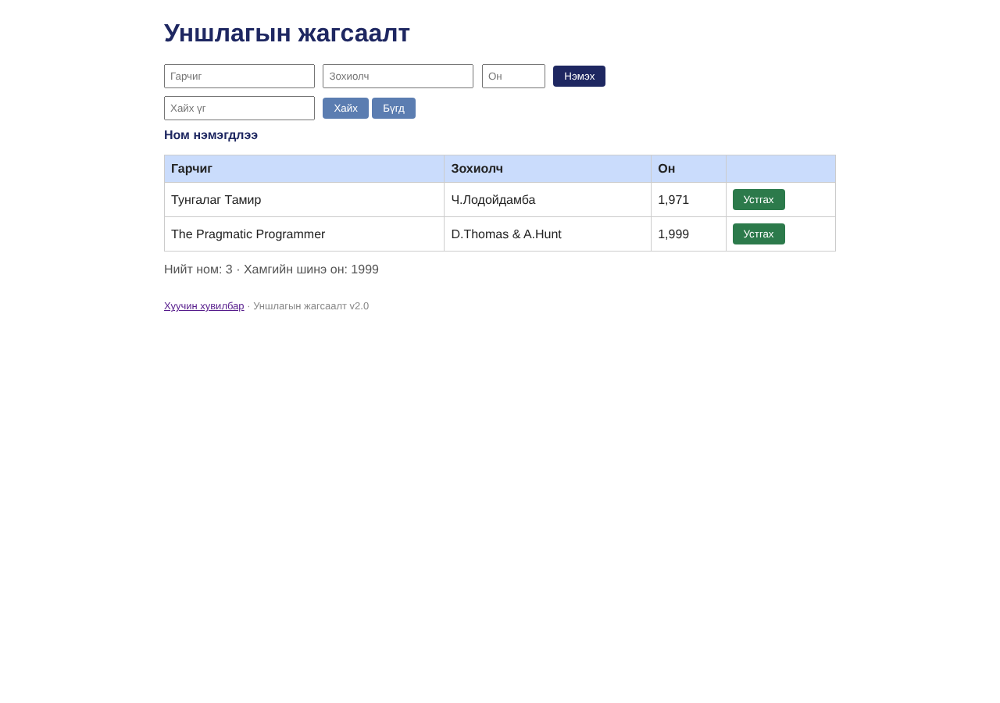

# BUG-09: Ном устгахад «Ном нэмэгдлээ» гэсэн буруу мессеж гардаг

Орчин:  Уншлагын жагсаалт v2.0, Chromium 153.0.8010.12, Linux x86_64 (Node.js v22.23.4), 2026-10-24

Урьдчилсан нөхцөл: node app.js-ийг шинээр асаасан (анхны 3 ном), браузерт http://localhost:3000 нээсэн

## Дахин гаргах алхам

1. «Clean Code» мөрийн «Устгах» товчийг дарна.
2. Хүснэгт ба мессежийг харна.

Хүлээгдэж байсан: Спец: «Үйлдэл бүрийн дараах мессеж тухайн үйлдэлдээ тохирно.» Устгасны дараа «Ном устгагдлаа» төрлийн мессеж.

Бодит үр дүн:     Мөр устаж 2 мөр үлдэнэ, гэвч мессеж «Ном нэмэгдлээ» гэж гарна.

Ноцтой байдал: Minor — функц ажиллана, мессеж хэрэглэгчийг төөрөгдүүлнэ.

Хавсралт:      

Олдсон аялал:  Supermodel
