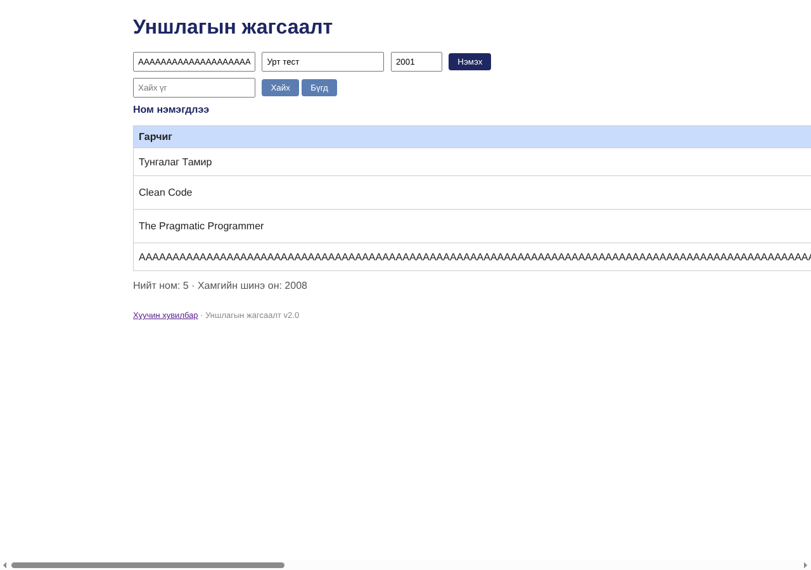

# BUG-10: Зайгүй урт гарчиг хүснэгтийг цонхноос хэтрүүлж, «Устгах» товчийг дэлгэцээс гаргадаг

Орчин:  Уншлагын жагсаалт v2.0, Chromium 153.0.8010.12, Linux x86_64 (Node.js v22.23.4), 2026-10-24

Урьдчилсан нөхцөл: node app.js-ийг шинээр асаасан (анхны 3 ном), браузерт http://localhost:3000 нээсэн

## Дахин гаргах алхам

1. Браузерын цонхыг ойролцоогоор 1280px өргөнтэй болгоно.
2. Гарчиг талбарт зайгүй 300 тэмдэгт (жишээ нь «A»-г 300 удаа) оруулж, Зохиолч «Урт тест», Он «2001» бөглөөд «Нэмэx» дарна.
3. Хүснэгтийг харна.

Хүлээгдэж байсан: Спец: «хүснэгт ямар ч урттай оролтод эвдрэхгүй.» Урт текст мөр шилжих эсвэл товчлогдох ёстой.

Бодит үр дүн:     Гарчгийн багана бүх өргөнийг эзэлж хуудас ~3700px болж хэвтээ гүйлгэх мөр гарна; Зохиолч, Он, «Устгах» багана дэлгэцээс гарч харагдахгүй.

Ноцтой байдал: Minor — өгөгдөл хадгалагдана, гэвч бусад мөрийн «Устгах» товч харагдахгүй болж хэрэглээ хүндэрнэ.

Хавсралт:      

Олдсон аялал:  Supermodel, Couch Potato
