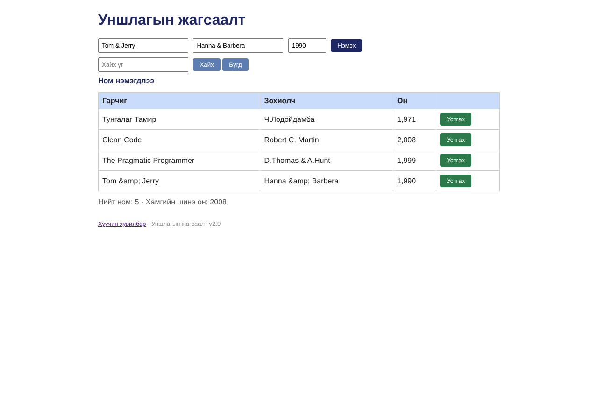

# BUG-13: «&» тэмдэгттэй гарчиг/зохиолч «&amp;» болж хадгалагдаж, хүснэгтэд «Tom &amp; Jerry» гэж харагддаг

Орчин:  Уншлагын жагсаалт v2.0, Chromium 153.0.8010.12, Linux x86_64 (Node.js v22.23.4), 2026-10-24

Урьдчилсан нөхцөл: node app.js-ийг шинээр асаасан (анхны 3 ном), браузерт http://localhost:3000 нээсэн

## Дахин гаргах алхам

1. Гарчиг «Tom & Jerry», Зохиолч «Hanna & Barbera», Он «1990» бөглөж «Нэмэx» дарна.
2. Хүснэгтийн шинэ мөрийг харна.
3. (API) `curl -i localhost:3000/api/books` -> сүүлийн номын title-ийг харна.

Хүлээгдэж байсан: Эрүүл ухаан: оруулсан текст өөрчлөгдөхгүй хадгалагдаж «Tom & Jerry» гэж харагдана (анхны «D.Thomas & A.Hunt» зөв харагддагтай адил). Спец: хүснэгт ямар ч оролтод эвдрэхгүй.

Бодит үр дүн:     Хүснэгтэд «Tom &amp; Jerry», «Hanna &amp; Barbera» гэж харагдана. API-д `"title":"Tom &amp; Jerry"` хадгалагдсан — сервер өгөгдлийг HTML-escape хийж хадгалдаг тул UI давхар escape хийнэ. «<b>», «<» зэрэг тэмдэгт ч «&lt;b&gt;» болж харагдана.

Ноцтой байдал: Minor — өгөгдлийн (хадгалалтын) түвшний гажуудал; хайлт, давхардлын шалгалт, экспорт зэрэгт буруу утга дамжина.

Хавсралт:       · [evidence/bug-13-curl.txt](../evidence/bug-13-curl.txt)

Олдсон аялал:  Saboteur, Couch Potato
